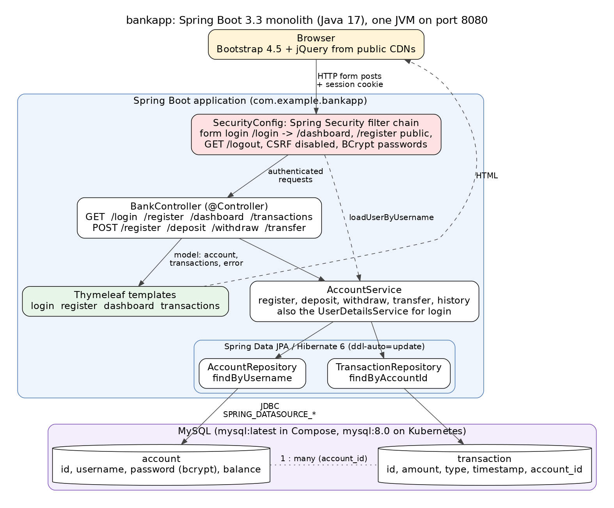

# Application architecture

This describes what the code on the `DevOps` branch does today. The bank app is a single Spring Boot 3.3 service (Java 17) that renders server-side HTML with Thymeleaf and stores accounts and transactions in MySQL through Spring Data JPA. There is no separate frontend, API gateway or message broker.

Editable source: [`docs/diagrams/architecture.dot`](diagrams/architecture.dot) (Graphviz). Re-render the PNG and SVG with [`docs/diagrams/render-architecture.sh`](diagrams/render-architecture.sh); the SVG is at [`images/architecture.svg`](../images/architecture.svg).

## Components

| Layer | Code | What it does |
| --- | --- | --- |
| Entry point | `BankappApplication` | `@SpringBootApplication`; embedded Tomcat on port 8080. |
| Security | `config/SecurityConfig` | Form login at `/login` (success redirects to `/dashboard`), `/register` open to everyone, every other URL needs a signed-in user. `GET /logout` invalidates the session and redirects to `/login?logout`. CSRF protection is disabled. Passwords use `BCryptPasswordEncoder`. |
| Web | `controller/BankController` | `GET /login`, `GET/POST /register`, `GET /dashboard`, `POST /deposit`, `POST /withdraw`, `POST /transfer`, `GET /transactions`. Reads the signed-in username from the `SecurityContext`, calls `AccountService`, then redirects or renders a template. Errors (for example "Insufficient funds") are put on the model and the dashboard or register page is shown again. |
| Views | `src/main/resources/templates/*.html` | Thymeleaf pages `login`, `register`, `dashboard`, `transactions`. Styling and the navbar script come from Bootstrap 4.5, jQuery and Popper on public CDNs; there are no local static assets besides the images. |
| Service | `service/AccountService` | Registers accounts (rejects a duplicate username, encodes the password, balance starts at 0), deposits, withdrawals, transfers between usernames, and transaction history. It is also the `UserDetailsService` that Spring Security uses to load a user at login. |
| Persistence | `repository/AccountRepository`, `repository/TransactionRepository` | Spring Data JPA interfaces: `findByUsername` and `findByAccountId`. |
| Model | `model/Account`, `model/Transaction` | `Account` (`id`, `username`, `password`, `balance`) implements `UserDetails` with a single `USER` authority. `Transaction` (`id`, `amount`, `type`, `timestamp`) belongs to one account. Hibernate creates and updates the `account` and `transaction` tables (`ddl-auto=update`); there are no migration scripts. |

## Request flows

- **Register**: `POST /register` → `AccountService.registerAccount` → new `account` row → redirect to `/login`.
- **Sign in**: Spring Security posts `/login` to `AccountService.loadUserByUsername`, checks the BCrypt hash and stores the user in the HTTP session.
- **Deposit / withdraw**: the controller loads the signed-in account, the service changes `balance`, saves the account and saves one `transaction` row (`Deposit` or `Withdrawal`). A withdrawal larger than the balance throws and the dashboard shows the error.
- **Transfer**: the service checks the sender's balance, looks up the recipient by username, updates both balances and writes a `Transfer Out to <user>` row for the sender and a `Transfer In from <user>` row for the recipient.
- **History**: `GET /transactions` lists the signed-in account's rows; the page colours `Deposit` and `Transfer In` green and everything else red.

## Configuration

`src/main/resources/application.properties` points at `jdbc:mysql://localhost:3306/bankappdb` with user `root`. Every way of running the app in this repo overrides that with the `SPRING_DATASOURCE_URL`, `SPRING_DATASOURCE_USERNAME` and `SPRING_DATASOURCE_PASSWORD` environment variables:

| Where | Database | How it is wired |
| --- | --- | --- |
| `docker-compose.yml` | `mysql:latest` container, database `BankDB` | App image `${DUSER}/${IMAGE}` on host port 8080. |
| `e2e/docker-compose.e2e.yml` | Same Compose stack, project `bankapp-e2e` | App on host port 8081 (`E2E_APP_PORT`), seeded by `e2e/seed/seed.sql`. See [docs/testing/e2e.md](testing/e2e.md). |
| `kubernetes/` (synced by ArgoCD) | `mysql:8.0` Deployment with a PV/PVC | Values come from `configmap.yaml` and `secrets.yaml`; `bankapp-service` is a ClusterIP service reached through `bankapp-ingress` (ingress-nginx, cert-manager TLS). An HPA scales the app Deployment. |
| `helm/bankapp/` | MySQL StatefulSet | Same app, exposed as a NodePort service on 30080. |
| Tests | In-memory H2 | `src/test/resources/application-test.properties`, used by `BankappApplicationTests` through `@ActiveProfiles("test")`. |

## Build, test and delivery

- `./mvnw clean test` runs the Spring context test against H2; `./mvnw clean package` builds `target/bankapp-0.0.1-SNAPSHOT.jar`.
- The `Dockerfile` builds the jar with Maven (tests skipped) and runs it on an Eclipse Temurin 17 JRE.
- The Cypress suite in `e2e/` signs in, deposits, withdraws, transfers and checks history in a real browser against the Compose stack. It runs in the Jenkins `E2E: Cypress smoke suite` stage and in the GitHub Actions workflow `.github/workflows/e2e.yml`.
- Jenkins CI (`Jenkinsfile`, shared library steps in `vars/`) runs Trivy, OWASP Dependency-Check, SonarQube with its quality gate, the Docker build, Cypress, and pushes the image to Docker Hub. It then triggers the CD job (`GitOps/Jenkinsfile`), which is meant to update the image tag in `kubernetes/`, push that commit to GitHub and send an email; ArgoCD deploys `kubernetes/` to EKS. As written, the CD job's `sed` targets `bankapp-deployment.yaml` while the manifest is `kubernetes/bankapp-deployment.yml`, so the tag update does not apply to it. See [cicd.md](../cicd.md) and the [README](../README.md) for the AWS setup.
